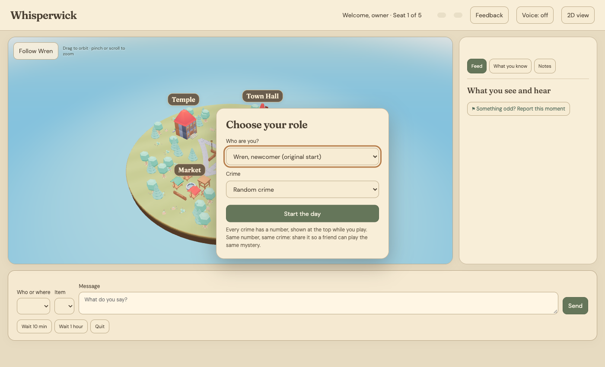
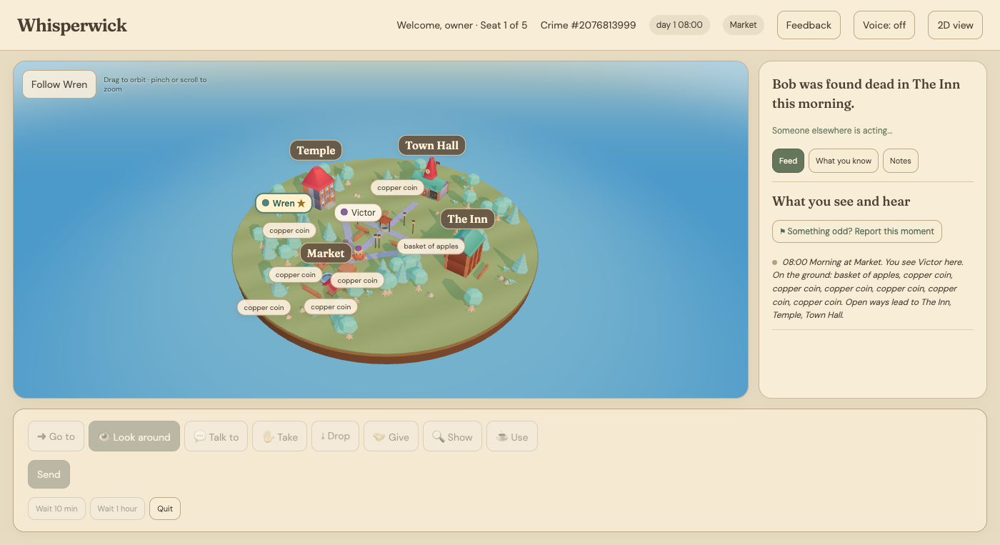

# Whisperwick

A small village where every villager is an LLM agent.
Each villager believes its own version of events.
Only the world engine decides what is actually true.

> Status: **Weeks 1-12 done; 13-17 built, being measured.** Weeks 1-6 built the engine, the player, cited beliefs,
> arrests and endings, and a playable demo. Weeks 7-12 measured why villagers fail and checked run-to-run noise.
> Weeks 13-15 added player roles, an ending report, random crimes, a 3D view, voice, a narrator line and live talk.
> Week 16 added more villager actions. Week 17 added role choice in 3D and villager lives (routines, worries, secrets).
> Open work: find which change after week 12 made seed 2 fail more often (#126), then harden the public demo (#127).
> See [docs/week17-plan.md](docs/week17-plan.md).

## What it looks like



The 3D village (`whisperwick play --web`, then open `/3d`). A new player picks a role and a crime
(random, or a number so a friend can play the same mystery), then starts the day.



A game in progress: the crime number is at the top, the feed on the right tells you what you
see and hear, and the buttons below are the things you can do. The village is the same
physics-only world every time; the villagers decide the rest.

## The question

Can a player's actions change an emergent story, while the story stays coherent
and every belief stays traceable to its source ("Alice thinks Bob did it, because Sarah told her")?

The long-term goal is a Skyrim-like world where agents keep the story moving and the player changes it.
This prototype builds the "brain" in text first. See [docs/roadmap.md](docs/roadmap.md).

## Core rule

- **Agents decide intentions. The world engine decides reality.**
- If something has a correct answer (who saw it, did the theft work), it lives in code.
- The LLM only decides what to say, and whether to lie.

## Quick start

```bash
uv sync                      # install dependencies
uv run whisperwick run       # run the default scenario for one game day
uv run pytest                # run every engine check (see VERIFY.md)
```

To use a real model, copy `.env.example` to `.env` and set the server and model first.

```bash
uv run whisperwick run --agent llm --days 3   # 3 game days with the model, saved to data/
uv run whisperwick story data/run-<name>.db   # read the run as a transcript (no model)
```

## Play

```bash
uv run whisperwick play --days 1                          # you play Wren in the terminal
uv run whisperwick play --script players/blame_hal.yaml   # a scripted player
uv run whisperwick play --web                             # play in a web page (2D, or /3d for the 3D village)
```

Both need a model server (see `.env.example`). Type `help` in the game for commands.

The 2D page first asks you to choose the mayor's cousin (`cousin`), a travelling peddler
(`peddler`), Victor's old business partner (`partner`), or the original newcomer start.
Each role has starting items and one private fact under **What you know**. The cousin
and partner also have one villager who already knows them. Villagers decide how to respond.
`--role` preselects a role in the web picker and selects it directly for terminal or script play:

```bash
uv run whisperwick play --role cousin --seed 1
uv run whisperwick play --role peddler --seed 1
uv run whisperwick play --role partner --seed 1
uv run whisperwick play --web --role partner --seed 1
uv run whisperwick play --role peddler --script players/none.yaml --days 3 --seed 1
```

Web play defaults to one village day. Explicit `--days` values are preserved, including
three-day scripted measurements. Omitting `--role` keeps the original world start.
At the end of a web game, privately name someone or nobody to reveal the ending.
The accusation is saved in the run's JSON sidecar; villagers never see it.
The report gives the truth, Hal's custody and arrest times, your accusation, and counted
gives and shows to Victor. Read the same report later without calling a model:

```bash
uv run whisperwick outcome data/web-YYYYMMDD-HHMMSS-1.db
```

After each run every villager is interviewed (who killed the mayor?), saved in the sidecar JSON.
Compare runs side by side (suspects, where items ended up, key events), no model needed:

```bash
uv run whisperwick compare data/run-a.db data/run-b.db
```

Trace a rumour: who suspects Hal, and the chain behind each belief (who told whom, back to
something seen first-hand or a lie with no source). Reads the belief log, no model;
add `--json` for the same thing as data. Older runs without a belief log print a short message:

```bash
uv run whisperwick trace data/run-a.db npc_hal
```

Measure runs (`eval`), judge them (`judge`), or screen a new model against saved turns in minutes
before any full run (`screen`, see issue #67):

```bash
uv run whisperwick eval data/run-a.db data/run-b.db
uv run whisperwick screen run data/screen/qwen-turns.json --out data/screen/new-model.json
```

## How an agent acts

Agents never touch the world directly. They send an intent, and the engine decides:

```python
world.act({"actor": "npc_bob", "action": "talk", "target": "npc_victor", "message": "Morning."})
# -> ActionResult(ok=True, event=...)    or    ActionResult(ok=False, reason="npc_victor is not here")
```

Actions so far: `move`, `talk`, `look`, `take`, `drop`, `give`, `show`, `use`, `wait`, plus `gesture` and `make`
(week 16, see [docs/week16-actions.md](docs/week16-actions.md)). Hal alone can `arrest` and `release`.

## Layout

```
whisperwick/     the engine (clock, events, actions, world, stub agent, CLI)
whisperwick/web3d/  the 3D village page (figures, voice, ending report)
whisperwick/crime/  random crimes (killer, victim, accomplices, villager lives)
scripts/         batch and server helper scripts
players/         scripted player files
scenarios/       YAML scenarios, e.g. Murder of the Mayor
tests/           pytest tests
docs/            design notes and the proposal
data/            local SQLite event logs (git-ignored)
```

## Roadmap

| Week | Focus | Exit check |
|---|---|---|
| 1 | Engine skeleton | A seeded run replays identically, no LLM |
| 2 | Vertical slice (local ~30B model) | **Gate 1:** a readable murder story from 5 NPCs |
| 3 | Player + real objects | Same seed, 3 player scripts, 3 different outcomes |
| 4 | Beliefs and rumours | A player's lie can be traced: who believes it, and via whom |
| 5 | Consequences + endings | Story ends in an engine-decided outcome |
| 6 | Evaluate + playable demo | Done: villager memory, evaluation runs, terminal and web demo |
| 7 | Why villagers fail | Done: five checks measured (#61, #62) |
| 8 | Behaviour + speed | Done: evidence heading kept (right person 8/10); speed items dropped |
| 9 | Model screen + group turns | Done: screen works (#67); group turns and vLLM not kept (#68, #64) |
| 10 | Player effect + Gate 2 | Done, see [week10-plan.md](docs/week10-plan.md) |
| 11 | Recall search | Done, see [week11-plan.md](docs/week11-plan.md) |
| 12 | Noise check + everyday items | Done: 5 runs per seed are enough (#90); items opt-in (#95) |
| 13 | Player roles + ending report | Built; check runs in progress (#97), see [week13-plan.md](docs/week13-plan.md) |
| 14 | Random crimes (any killer, any victim, accomplices) | Built; creative-model check to do (#104), see [week14-plan.md](docs/week14-plan.md) |
| 15 | Narrator + live talk | Built (#108, #106); latency check to do, see [week15-plan.md](docs/week15-plan.md) |
| 16 | More villager actions (gesture, make) | Built, see [week16-plan.md](docs/week16-plan.md) |
| 17 | Role choice in 3D + villager lives | Built; seed 2 drop under study (#126), see [week17-plan.md](docs/week17-plan.md) |
| later | **Gate 2** | GO (front-end) / PIVOT / STOP, once the villagers work |

Everything runs locally (a local model on an RTX 5090, served by llama-server). No paid APIs.

## License

MIT
